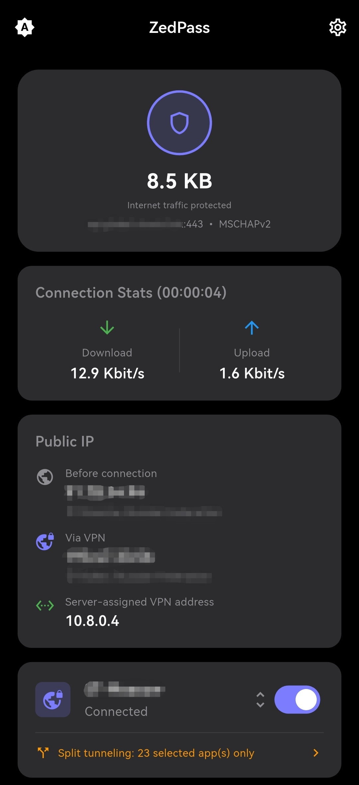
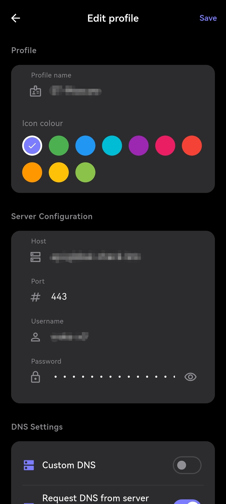
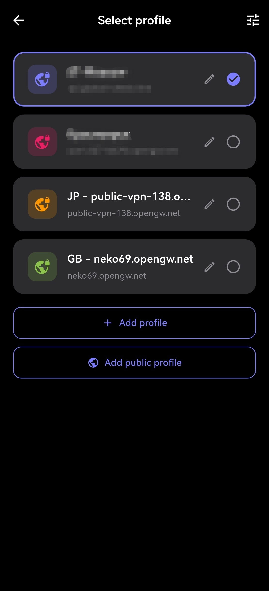

# SoftSSTP

[English](README.md) · **Русский**

Открытый VPN-клиент для Android на Flutter, интерфейс в стиле Material Design 3.
Понимает два протокола: Microsoft SSTP (MS-SSTP) и SoftEther (SSL-VPN поверх TCP).
Работает с [SoftEther VPN Server](https://www.softether.org/),
[VPN Azure Cloud](https://www.vpnazure.net/) и публичными серверами
[VPN Gate](https://www.vpngate.net/).

[](https://github.com/MrKsey/SoftSSTP/actions/workflows/release.yml)


## Скриншоты

<p align="center">
  &nbsp;&nbsp;&nbsp;&nbsp;&nbsp;&nbsp;&nbsp;&nbsp;&nbsp;&nbsp;&nbsp;&nbsp;
  &nbsp;&nbsp;&nbsp;&nbsp;&nbsp;&nbsp;&nbsp;&nbsp;&nbsp;&nbsp;&nbsp;&nbsp;
  
</p>

## На основе

| Слой | Проект | Роль |
|------|--------|------|
| SSTP / PPP / TLS | [kittoku/Open-SSTP-Client](https://github.com/kittoku/Open-SSTP-Client) (MIT) | Исходный Android-клиент SSTP, отсюда взят движок протокола. |
| Плагин Flutter | [NavidShokoufeh/sstp_flutter](https://github.com/NavidShokoufeh/sstp_flutter) | Flutter-обёртка над этим движком. |
| SoftEther / SSL-VPN | [hoang-rio/SoftEther-Android-Module](https://github.com/hoang-rio/SoftEther-Android-Module) (Apache-2.0) | Встроенный в проект клиент SoftEther (ядро на C, JNI, Kotlin) для плагина `softether_flutter`. |
| Криптография TLS | [OpenSSL](https://www.openssl.org/) (Apache-2.0) | Собирается из исходников для клиента SoftEther (см. `softether_flutter`). |
| Базовое приложение | [CluvexStudio/ZedPass](https://github.com/CluvexStudio/ZedPass) | Проект, с которого начался форк. |

## Возможности

- Material Design 3 с темой Material You. Дневной, ночной и авто режим, иконка в
  левом верхнем углу переключает между ними.
- Несколько профилей VPN. В каждом свои протокол, сервер, DNS, прокси, PPP,
  маршрутизация, раздельное туннелирование, автопереподключение и дополнительные
  параметры, плюс имя и цвет иконки. Активный профиль выбирается на главном экране,
  новый сохраняется по кнопке Save.
- Два протокола на профиль: Microsoft SSTP и SoftEther (SSL-VPN поверх TCP). У
  профиля SoftEther дополнительно задаётся виртуальный хаб (у серверов VPN Gate это
  `VPNGATE`, у своих профилей по умолчанию `DEFAULT`), необязательный MAC-адрес
  клиента и число параллельных TCP-соединений (по умолчанию 2, у профилей из VPN Gate
  1, поднимается в редакторе до 8).
- Публичные профили из VPN Gate. В списке видно страну, качество линии и пинг,
  измеренный с вашего устройства, а также фильтр по протоколу. Любой сервер
  добавляется одним нажатием, логин и пароль `vpn`.
- Подключение и отключение с контролем состояния на главном экране и в уведомлении.
- Текущая скорость в битах и общий объём трафика в байтах.
- Публичный IP и геолокация до и после подключения, плюс внутренний IP, который
  выдал сервер.
- Раздельное туннелирование. В туннель идут только выбранные приложения, есть поиск
  по списку. Выбор сохраняется, даже если правило выключить.
- Автопереподключение с настройкой числа попыток и интервала.
- Возврат VPN-слота. Если другое VPN (например AdGuard) отбирает слот, SoftSSTP
  забирает его обратно и переподключается.
- Восстановление при смене сети. Переключение между Wi-Fi и мобильными данными
  пересобирает туннель автоматически.
- Настройка DNS, прокси, SSL и PPP. Свой DNS, HTTP-прокси, свой SNI, версия SSL,
  проверка имени хоста и сертификата, MTU/MRU, протокол аутентификации, IPv4/IPv6,
  статический IP и маршрутизация.
- Счётчики трафика переживают выключение экрана и пересоздание приложения.
- Энергосбережение при выключенном экране: обновление статистики раз в секунду,
  перерисовка уведомления и опрос сокета останавливаются, а процессор спит между
  keepalive и реальным трафиком. Переключатель Energy saving в настройках растягивает
  те же циклы ещё и при включённом экране.
- Диагностика подключения. Оба протокола пишут в один файл
  `Android/data/io.github.mrksey.softsstp/files/connection_log.txt`, а экран
  View connection log показывает его прямо в приложении. Логирование по умолчанию
  выключено, включается в настройках, там же переключатель статистики по TCP-линкам.

## Требования

- Android 8.0 (API 26) или новее
- Доступный SSTP- или SoftEther-сервер (SSL-VPN, TCP) с включённым DHCP
- Для SSTP только PAP и MS-CHAPv2, без EAP

## Установка

1. Откройте страницу [Releases](https://github.com/MrKsey/SoftSSTP/releases).
2. Скачайте APK под своё устройство:
   - `SoftSSTP-<версия>-arm64-v8a.apk` для современных 64-битных устройств
     (рекомендуется)
   - `SoftSSTP-<версия>-armeabi-v7a.apk` для старых 32-битных устройств
3. Установите APK. Если система попросит, разрешите установку из браузера или
   файлового менеджера.
4. Откройте SoftSSTP, зайдите в Настройки, введите данные сервера и подключитесь.

Все релизы подписаны одним сертификатом, поэтому обновления ставятся поверх
предыдущей версии без удаления.

Публикация в F-Droid на рассмотрении, рецепт сборки лежит в `fdroid/`, тексты
изменений в `fastlane/metadata/android`. Сборка воспроизводимая, поэтому F-Droid
публикует APK с этой страницы, а не собственную пересборку.

## Использование

1. Нажмите на шестерёнку, чтобы открыть Настройки. Блок Profiles добавляет,
   редактирует, включает и удаляет профили, там же лежат Diagnostics и About.
2. Откройте профиль и укажите Хост, Порт (по умолчанию 443), Логин и Пароль.
   Выберите протокол: SSTP или SoftEther. Для SoftEther дополнительно задайте
   виртуальный хаб (у серверов VPN Gate это `VPNGATE`, у своих профилей по умолчанию
   `DEFAULT`) и, при необходимости, MAC-адрес клиента.
   При желании задайте имя и цвет иконки, затем нажмите Save.
3. При необходимости настройте DNS, прокси, SSL, PPP, маршрутизацию и раздельное
   туннелирование. DNS, прокси, SSL и PPP относятся к SSTP, клиент SoftEther
   подключается к SSL-VPN-порту сервера и их не использует. Маршрутизация и
   раздельное туннелирование работают для обоих протоколов.
4. Для готового сервера нажмите Add public profile и выберите один из списка
   VPN Gate.
5. На главном экране нажмите на карточку сервера, чтобы сменить профиль, затем
   нажмите кнопку подключения. Повторное нажатие или касание уведомления отключает
   VPN.
6. Если подключение не проходит, включите логирование в Settings, Diagnostics и
   откройте экран View connection log.

## Настройки

Экран Settings собран из блоков.

- Profiles: список профилей, добавление, редактирование, экспорт, отправка, выбор
  активного и удаление. Здесь же Add public profile и Import profile.
- Diagnostics: переключатель Connection logging, переключатель Per-link statistics и
  вход на экран View connection log.
- Background: системное исключение из оптимизации батареи и переключатель Energy
  saving. Без исключения Android может останавливать VPN в фоне. Приложение и так
  экономит само: при выключенном экране оно перестаёт раз в секунду обновлять
  статистику, не перерисовывает уведомление, реже опрашивает сокет и даёт процессору
  заснуть, пробуждая его только под keepalive и реальный трафик (так же ведёт себя
  shadowsocks-android). Energy saving - это дополнительный переключатель поверх этого:
  он растягивает те же циклы ещё и при включённом экране, поэтому статус и скорость
  обновляются медленнее; сама скорость трафика не меняется. По умолчанию выключен, при
  тестах его можно выключить обратно.
- Update: переключатель автопроверки при запуске, пункт Check now и, когда есть
  свежий релиз, пункт, который открывает страницу релиза в браузере. Приложение
  только читает релизы на GitHub, само APK оно не скачивает и не ставит, поэтому
  разрешение на установку приложений не запрашивается, а одна и та же сборка годится
  и для F-Droid.
- Donate и About: кошельки для доната и ссылки на проект.

Профиль открывается нажатием и состоит из своих блоков.

- Profile: имя и цвет иконки.
- Server Configuration: хост, порт, логин, пароль, протокол. Для SoftEther ещё
  виртуальный хаб и необязательный MAC-адрес клиента.
- DNS Settings: свой DNS-сервер и запрос DNS у сервера.
- Proxy Settings и PPP, только для SSTP: HTTP-прокси, MTU/MRU, протокол
  аутентификации и её таймаут, IPv4/IPv6, статический адрес.
- SoftEther, только для SoftEther: число TCP-соединений, интервал установки, MTU,
  шифрование сессии через SSL, отключение UDP-ускорения и QoS.
- Routing: маршрут по умолчанию и маршруты приватных адресов.
- App Routing: раздельное туннелирование, сохранение и загрузка списка приложений.
- Reconnection: число попыток и интервал.
- Advanced и Certificate, только для SSTP: проверка имени хоста и сертификата, версия
  SSL, свой SNI, добавление доверенного сертификата.

Логирование соединения и статистика по линкам выключены по умолчанию, включать их
стоит на время разбора проблемы. Лог общий для обоих протоколов, каждая сессия
открывается заголовком `=== NEW ... SESSION ===`, в нём же указана версия приложения.
Файл ограничен 512 КБ, при переполнении он очищается и пишется заново.

## Решение проблем

### Работает другое VPN (AdGuard)

Android разрешает активным только один VPN одновременно. Перед подключением
SoftSSTP занимает VPN-слот, поэтому обычно вытесняет другое VPN сам. Если то VPN
снова перехватывает слот (у него есть сторож) или туннель переподключается на
глазах, так и задумано. SoftSSTP дожидается, пока другое VPN запустится, забирает
слот и снова поднимает туннель, а уведомление показывает, что происходит.

Если слот удержать не удаётся, у другого приложения, скорее всего, включён
постоянный VPN (Always-on VPN), который система не разрешает вытеснять:

- отключите постоянный VPN у другого приложения (Настройки, Сеть и интернет, VPN,
  значок шестерёнки);
- или добавьте SoftSSTP в список исключений (в AdGuard: Настройки, Управление
  приложениями, SoftSSTP, Обход);
- или переключите AdGuard в режим прокси вместо режима VPN.

### Смена сети (Wi-Fi и мобильные данные)

Сокет SSTP привязан к текущей сети, поэтому её смена разрывает туннель. SoftSSTP
следит за сетью и пересобирает туннель в новой сам, подключаться вручную не нужно.
Число попыток для этого и для возврата слота ограничено, так что мигающая сеть или
постоянный перехват не зациклят подключение.

### Лог подключения

Логирование выключено по умолчанию, поэтому включите Connection logging до того, как
воспроизведёте проблему. Лог пишут оба протокола в один файл, новая сессия начинается
с заголовка `=== NEW ... SESSION ===`, рядом видна версия приложения и время
установки APK. Экран View connection log показывает путь к файлу, лог можно
скопировать в буфер и очистить. Для отчёта об ошибке приложите файл целиком.

### Дополнительные TCP-соединения SoftEther

Число параллельных TCP-соединений задаётся в профиле в блоке SoftEther, от одного до
восьми. У своего сервера по умолчанию два, у профиля из списка VPN Gate одно, но
публичные серверы обычно тянут и больше, так что на быстром сервере число стоит
поднять. Если дополнительные линки не поднимаются, в логе видно, сколько линков
реально поднялось и на чём упал каждый неудачный. Переключатель Per-link statistics
добавляет раз в 5 секунд срез трафика по линкам, а срез при завершении сессии
пишется всегда.

Загрузка и отдача используют линки по-разному. Загрузку назначает сервер: он выделяет под
данные одно соединение и продолжает гнать туда, так что дополнительные линки несут только
keepalive и фоновый трафик, пока всё скачивание тянет одно соединение. Отдачу клиент
выбирает под каждый блок сам, но не размазывает по линкам: блок уходит в тот линк,
который последним отдал данные (правило LateCount из референсного клиента), а round-robin
включается только при равенстве. На практике почти вся отдача идёт по одному линку, обычно
по тому же, что несёт загрузку, и срез в конце сессии выглядит так:
`primary tx=137.5M rx=135.6M | addl1 tx=1.8M rx=262.4K`. Так что число соединений даёт
живучесть и выбор линка для сервера, а не прибавку к скорости отдачи.

Два соединения уже дают резерв. Если активный линк отвалится, сервер переведёт данные на
второй, и туннель переживёт обрыв, который оборвал бы одиночное соединение. Поднимать
больше двух незачем. На четырёх линках в замерах весь трафик всё равно шёл по одному, и
прибавки к скорости не было.

## Сборка из исходников

```bash
# Требуется: Flutter (stable), JDK 17, Android SDK и NDK.
# Плагин SoftEther во время сборки Gradle компилирует OpenSSL из исходников,
# поэтому нужны ещё bash, perl и make (на Linux/macOS/CI они есть, на Windows
# используйте WSL или Git Bash).

git clone --recursive https://github.com/MrKsey/SoftSSTP.git
cd SoftSSTP/SoftSSTP

flutter pub get
dart run flutter_launcher_icons

# Универсальный APK
flutter build apk --release

# APK по архитектурам (arm64 и arm)
flutter build apk --release --split-per-abi \
  --target-platform android-arm64,android-arm
```

Флаг `--recursive` подтягивает закреплённый сабмодуль OpenSSL, который нужен
плагину `softether_flutter`. Если клонировали без него, выполните
`git submodule update --init --recursive`.

Готовые APK Flutter кладёт в `build/app/outputs/flutter-apk/`, рядом Gradle пишет
копии с понятными именами в `build/app/outputs/apk/release/`.

Имя и код версии живут в `pubspec.yaml`. Split-сборка даёт каждой архитектуре свой
код версии: номер из pubspec умножается на 10, к результату прибавляется номер слота,
единица у armeabi-v7a и двойка у arm64-v8a. У универсального APK код остаётся
исходным. Те же слоты прописаны в `VercodeOperation` F-Droid-рецепта и в
`SoftSSTP/android/app/build.gradle.kts`.

CI собирает обе архитектуры при каждом пуше в `main`, а GitHub Release публикует при
пуше тега `v*`. Перед тегом поднимите версию в `pubspec.yaml` и закоммитьте, имя в
теге должно совпадать с версией. Сборки подписываются ключом из секретов репозитория.
Правки только в документации, `docs`, `fastlane` и `fdroid` сборку не запускают.

### F-Droid

Рецепт сборки лежит в `fdroid/io.github.mrksey.softsstp.yml`, тексты изменений для
F-Droid в `fastlane/metadata/android`. Плагин SoftEther собирает OpenSSL из
исходников, предсобранных `.so` в репозитории нет, поэтому рецепт указывает сабмодуль
и NDK. Каждой архитектуре достаётся отдельная запись с кодом версии из
`VercodeOperation`.

Сборка воспроизводимая. Рецепт следует шаблону `templates/build-flutter.yml`, переносит
рабочую копию в тот же путь, который использует раннер GitHub, и указывает `binary` на
APK соответствующего релиза. Поэтому F-Droid публикует APK со страницы релизов,
подписанный ключом автора, а `AllowedAPKSigningKeys` этот ключ закрепляет. Совпадению
сборок служат три детали: OpenSSL конфигурируется с фиксированным префиксом, дата его
сборки задана константой в скрипте, а build-id линкера отключён для всех нативных
модулей. Ничего в сборке не переключает приложение между каналами: при выходе новой
версии приложение только открывает страницу релиза и никогда не устанавливает APK
само, так что один APK подходит и для GitHub, и для F-Droid.

## Донаты

Поддержать проект можно донатом на любой из кошельков ниже.

<table>
  <tr>
    <td align="center">
      <br>
      <b>Bitcoin</b><br>
      <code>bc1qdf9wryj6tnyyr7ed4dkfv03nn0dxjf27xshfcr</code>
    </td>
    <td align="center">
      <br>
      <b>Ethereum</b><br>
      <code>0xE22FAB5337A5506D9e7Ef9D4914De4d963Fbbf88</code>
    </td>
  </tr>
  <tr>
    <td align="center">
      <br>
      <b>Solana</b><br>
      <code>7XcNM2M9rndFbJdjRtyycxkQXq8dPXEP87toiQX4EZfx</code>
    </td>
    <td align="center">
      <br>
      <b>Tron</b><br>
      <code>TCYpTxSmdPN8p4fmRwtPGk3HHBf77FypeA</code>
    </td>
  </tr>
</table>

## Лицензия

SoftSSTP распространяется под GNU General Public License v3.0, текст в
[`SoftSSTP/LICENSE`](SoftSSTP/LICENSE). Входящие компоненты сохраняют свои
лицензии. Гарантий нет.
